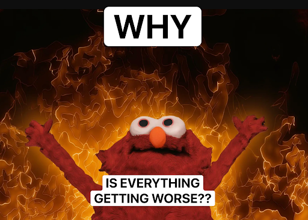
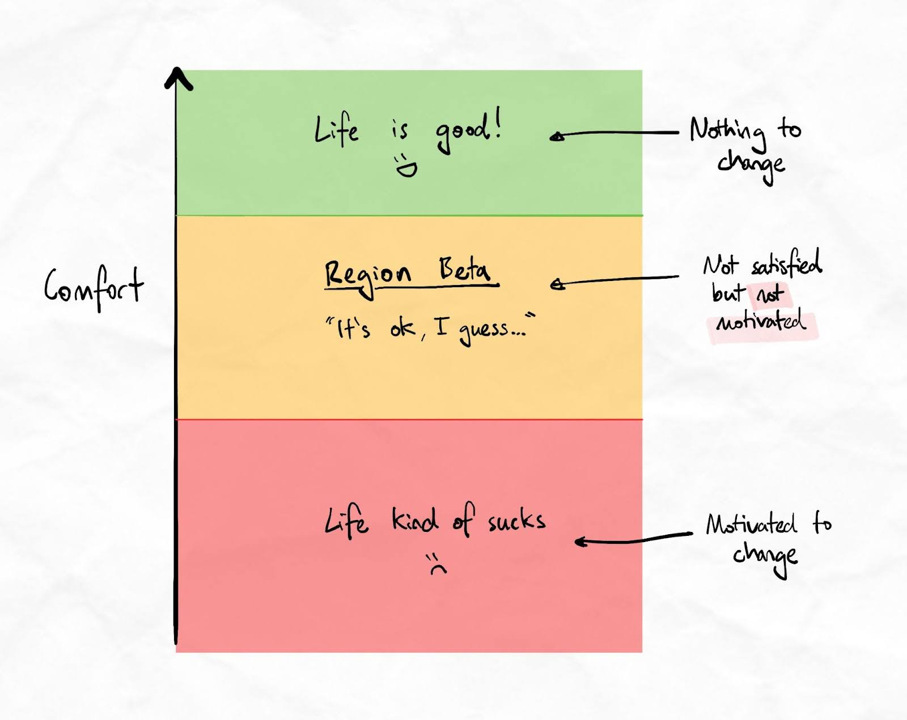

# Region beta paradox

- Source: email newsletter from Justin, iCanStudy. Send date not in the saved page.
- Captured: 2026-11-02. Text is verbatim, with `==` marking the email's highlights. Tracking links removed.
- Images: local copies in `region-beta_files/`.
- Unverified, and the email promotes the author's paid program.

---

Hooray! It turns out our brain has **even more ways** of sabotaging us from achieving our goals. Introducing the
**region beta paradox** 🙃

Most of us have a big change we want to make…

- Better grades
- Better work performance
- Better memory
- Ability to solve more complex problems
- Gaining REAL confidence with learning

And while we often start with motivation, many of us end up _dabbling_—giving it a try here and there without seeing
real results.

So here's an obvious question…

==**Why do we settle for small, inconsistent efforts that rarely lead to real transformation?**==

One surprising explanation lies in a psychological concept called the Region Beta Paradox.

## What is the Region Beta Paradox (and how does it sabotage us?)

The Region Beta Paradox, coined by psychologists Daniel Gilbert and Timothy Wilson, explains why **we're less likely to
make big changes when things are only mildly uncomfortable.**

It's the idea that when something isn't bad enough to trigger action, we stay stuck in a zone of _mild
dissatisfaction_—comfortable enough to tolerate, but not uncomfortable enough to drive real change.

==In other words, if a situation isn't terrible, we're more likely to cope with it than to push for improvement.==

When applied to learning to learn, the Region Beta Paradox can be why so many people dabble with tips and techniques
here and there **instead of** properly committing to making real changes to their results.

But it gets worse…

## What the Region Beta Paradox ruins your brain's ability to learn

Upgrading your skills to the point where you confidently get better grades or perform better at work takes a **change in
habits.**

Which means, we need to make use of our brain's neuroplasticity (aka, the brain's ability to rewire itself).

But here's the thing… Neuroplasticity takes more than just occasional effort.

==When we approach learning to learn casually, with sporadic, mild engagement, the brain doesn't see a reason to commit
resources to change.==

And because we never really push through the discomfort and force our brain to rewire itself, it makes us think, "I'll
try again tomorrow," or "I'll get to it when I have more time."

**Except, if that's what you think - you'll never have more time.**

So let's start making some real change so we can live the life we **actually want** to live.

## Breaking out of region beta

If you want to see real changes to your memory, ability to learn, performance at work and confidence with learning,
**you must commit to change**.

Which means breaking out of the Region Beta trap. So, here's how:

### First, recognize the paradox

Acknowledge when mild discomfort is keeping you complacent. If you're unhappy with your progress but not uncomfortable
enough to take action, this awareness can help you push yourself to the next level.

### Then, set deadlines

Don't just say "I'll change things eventually". Let's be real - you've been saying that to yourself for years. You owe
it to yourself to get moving!

Clear, actionable goals help you focus your efforts. Decide on a specific skill to practice, set a timeframe, and
**commit** to it with a frequency that will create momentum.

In my guided program, we teach people how to make 30-day rapid growth plans to push out of region beta ASAP. We've found
30 days works well, so you can try to start there.

### Next, push through

If you feel a bit challenged or frustrated, recognize it as a good sign. The brain needs this signal to start building
new pathways.

### And finally, don't hold back!

Sometimes, we need a little help to break out of Region Beta. Find an accountability partner, coach, or group that can
help push you when you're tempted to stay comfortable.

**If you need that coach and accountability partner for learning to learn, there's no better place than my guided
program here. There are thousands of other people going through the same journey, trying to improve their lives by
becoming a master of their brain.**

So go and break out of region beta and I'll see you next time 💥

Yours sincerely, Justin
